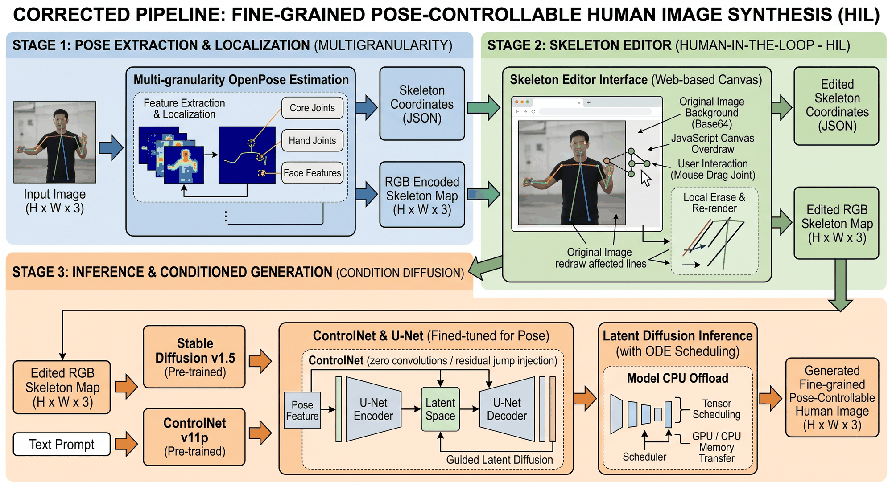
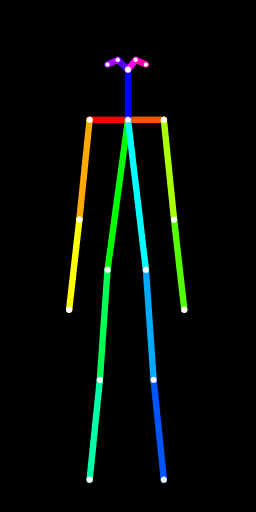
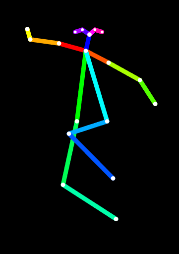
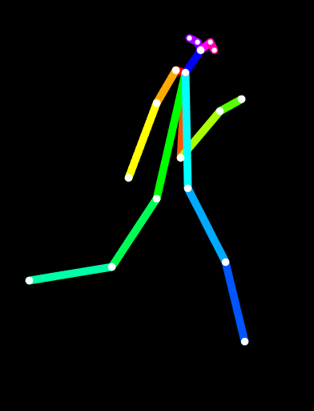
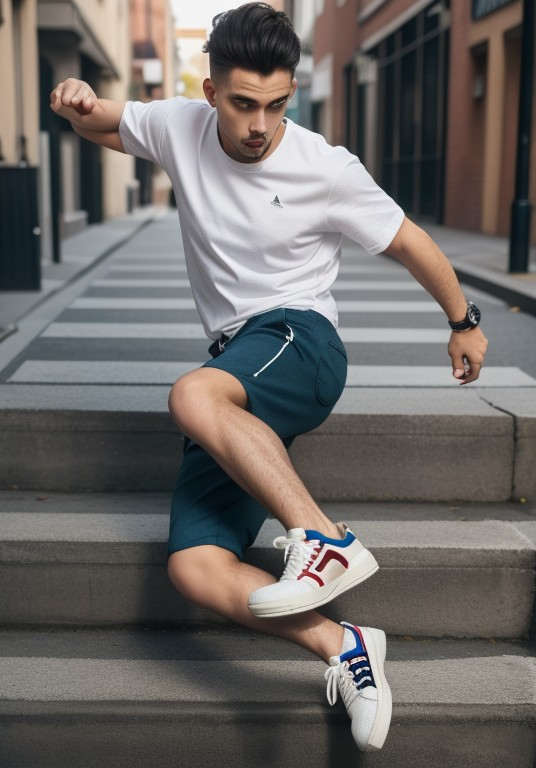
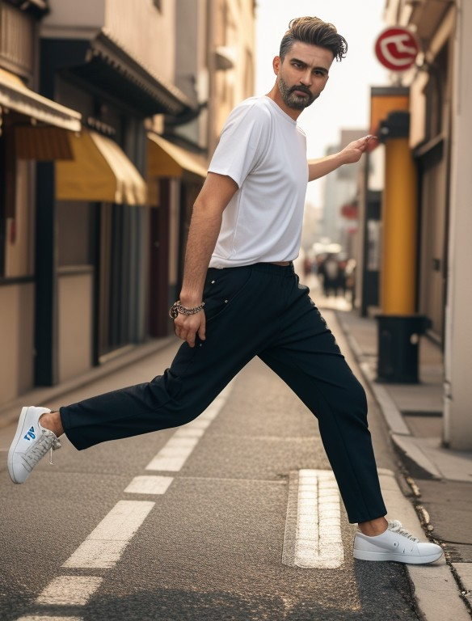
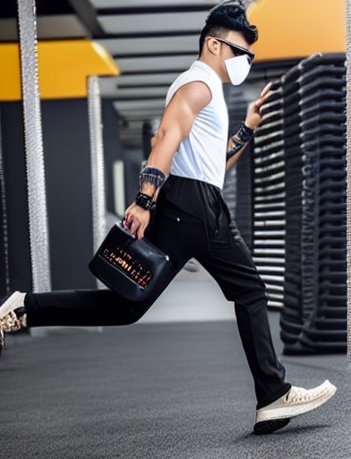
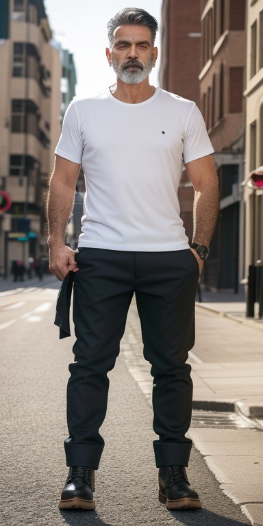

<div align="center">

# 细粒度姿态可控的人体图像生成

**Fine-grained Pose-Controllable Human Image Synthesis**

用「拖拽关节」精细改写人物姿态，再用 ControlNet 按新骨架重新生成

[](https://www.python.org/)
[](https://www.gradio.app/)
[](https://github.com/huggingface/diffusers)
[]
[](LICENSE)
[](https://github.com/Rambotx/fine-grained-pose-controllable-human-image-synthesis/actions/workflows/ci.yml)

[项目简介](#项目简介) · [效果展示](#效果展示) · [技术路线](#技术路线) · [快速开始](#快速开始) · [使用方式](#三种使用方式) · [已知限制](#已知限制)

</div>

---

## 项目简介

文生图模型很难用一句 prompt 精确控制人物姿态。本项目把「姿态」从提示词里拿出来，变成一个**可拖拽的骨架**：

1. **提取** —— 用 `controlnet_aux` 的 OpenposeDetector 从任意人物照片中提取 OpenPose 骨架（身体 / 手 / 脸可分别开关）；
2. **微调** —— 把骨架和 18 个身体关键点坐标注入一个自研的 HTML Canvas 编辑器，用户直接拖拽关节点摆出想要的动作，导出纯黑底骨架图；
3. **回传 + 生成** —— 点「导出并回传」，骨架通过 `POST /api/pose` 直接交给后端，再点「开始生成」，ControlNet（`lllyasviel/control_v11p_sd15_openpose`）+ Stable Diffusion 1.5 就会按新姿态重绘。

> 这是课程 / 大学生创新训练项目的工程原型，重点在于**把姿态编辑做成可视化交互**，而不是提出新的模型结构。

## 效果展示

### 系统流程



### 骨架编辑：检测结果可直接拖拽

| 站立 | 起跳 | 行走 |
| :---: | :---: | :---: |
|  |  |  |
| 原图检测得到的默认骨架 | 在编辑器里拖出的动作 | 编辑器导出的行走姿态 |

编辑器的逻辑是：检测到的关键点坐标会被**原样注入**画布，所以用户打开编辑器时看到的就是这张照片的真实姿态，可以在它基础上继续微调，而不用从 T-pose 重新摆。

### 生成结果

| 台阶动作 | 街拍行走 | 奔跑 |
| :---: | :---: | :---: |
|  |  |  |

| 另一组结果 |
| :---: |
|  |

> 以上人物图像均由 Stable Diffusion + ControlNet 生成，**不是真实人物照片**；质量受底模、提示词与种子影响。

## 技术路线

<details open>
<summary><b>1. 姿态提取（Pose Extraction）</b></summary>

- `controlnet_aux.OpenposeDetector` 完成多粒度检测：身体 18 点、手部 21 点、面部 70 点可分别开启；
- 身体关键点使用 COCO-18 顺序，直接对应 ControlNet 的条件图格式；
- 为了拿到可编辑坐标，脚本调用检测器内部的 `body_estimation` 取回 `candidate / subset`，再按原图宽高归一化成 18 个 `{x, y}`。

</details>

<details open>
<summary><b>2. 骨架编辑器 + 自动回传（Human-in-the-Loop）</b></summary>

- 单文件 HTML + Canvas，无前端框架依赖；
- 18 个关节点可拖拽，17 条肢体用固定色带绘制，导出前把背景刷成纯黑——这正好是 ControlNet 需要的条件图；
- 原图以 50% 透明度垫在画布下方作为参考；
- 点「导出并回传」后，画布 PNG 以 data URL 发到 `POST /api/pose`，生成时直接取用，**不再需要下载再上传**；
- 后端把姿态坐标用 `__INJECTED_POINTS__` 占位符写进模板，并用 `iframe srcdoc` 嵌回 Gradio 页面。

</details>

<details open>
<summary><b>3. 条件生成（Diffusion）</b></summary>

- `StableDiffusionControlNetPipeline` + `UniPCMultistepScheduler`；
- 先把骨架放大约 1.5 倍并向下对齐到 8 的倍数，再作为条件图生成；
- `enable_model_cpu_offload()` 让 8 GB 显存的卡也能跑起来（仅在 CUDA 下启用）；CUDA 下自动使用 fp16；
- 模型懒加载：界面先启动，真正点用时才加载/下载权重，缺权重时会给出可读错误而不是整个程序起不来。
- 支持任意 SD1.5 系底模：HuggingFace 仓库 id 或本地 `.safetensors / .ckpt`。

</details>

## 核心特性

- **可见即可拖**：检测出的关节点直接注入编辑器，改姿态不用从零摆骨架；
- **导出即回传**：编辑器 → 后端的闭环已经打通，省掉「下载 PNG 再上传」；
- **多种形态**：一体化 Gradio、FastAPI 前后端分离、纯离线单文件编辑器、独立骨架提取；
- **底模可替换**：默认 SD1.5，也可换任意真实感人像底模（如 majicmix），支持 HF 仓库 id 或本地 `.safetensors/.ckpt`；
- **懒加载 + 低显存**：没有权重也能打开界面，CPU offload + fp16 让 8 GB 显存可运行；
- **可测试**：坐标换算、尺寸计算、data URL 与仓库卫生都有单元测试，GitHub Actions 自动跑。

## 环境要求

- Python **3.10 ~ 3.12**（3.13 下 `controlnet_aux` 依赖的 mediapipe 可能报错）；
- 推荐 NVIDIA GPU，显存 ≥ 8 GB（fp16 + CPU offload）；CPU 也能跑但很慢；
- 磁盘预留约 **6 GB** 给模型权重；
- Windows / Linux 均可。

## 快速开始

### 1. 安装

```bash
git clone https://github.com/Rambotx/fine-grained-pose-controllable-human-image-synthesis.git
cd fine-grained-pose-controllable-human-image-synthesis

python -m venv .venv
# Windows
.venv\Scripts\activate
# Linux / macOS
# source .venv/bin/activate

# 先按自己的 CUDA 版本安装 torch（示例为 CUDA 12.1，无 GPU 则去掉 --index-url）
pip install torch torchvision --index-url https://download.pytorch.org/whl/cu121
pip install -r requirements.txt
```

### 2. 运行

```bash
python app.py
```

浏览器打开 <http://127.0.0.1:7860>。页面由 FastAPI 托管 Gradio 前端，同一个进程还提供：

| 接口 | 说明 |
| --- | --- |
| `POST /api/pose` | 编辑器回传骨架（data URL） |
| `GET /api/health` | 健康检查，返回设备与模型加载状态 |

首次点「提取骨架 / 开始生成」时会自动下载权重（约 5 GB，请留足磁盘与网络时间），也可以提前下载：

```bash
python scripts/download_models.py            # 全部
python scripts/download_models.py --controlnet
```

权重大小：

| 组件 | 来源 | 体积 |
| --- | --- | --- |
| OpenPose 注解器（身体/手/脸） | `lllyasviel/Annotators` | ~200 MB |
| ControlNet OpenPose | `lllyasviel/control_v11p_sd15_openpose` | ~700 MB（fp16） |
| SD 1.5 底模 | `stable-diffusion-v1-5/stable-diffusion-v1-5` | ~4 GB |

国内网络可先设置镜像：

```powershell
$env:HF_ENDPOINT = "https://hf-mirror.com"   # PowerShell
```

```bash
export HF_ENDPOINT=https://hf-mirror.com      # bash
```

### 3. 使用本地已有权重（可选）

已经在 ComfyUI / WebUI 里下过模型的话，不必重复下载：

```powershell
$env:BASE_MODEL    = "D:/models/majicmixRealistic_v7.safetensors"
$env:ANNOTATOR_DIR = "D:/ComfyUI/custom_nodes/comfyui_controlnet_aux/ckpts/lllyasviel/Annotators"
python app.py
```

```bash
BASE_MODEL=/models/majicmixRealistic_v7.safetensors \
ANNOTATOR_DIR=/models/annotators \
python app.py
```

### 环境变量

| 变量 | 作用 | 默认值 |
| --- | --- | --- |
| `ANNOTATOR_DIR` | 本地 OpenPose 注解器权重目录 | 空 → 自动下载 `lllyasviel/Annotators` |
| `CONTROLNET_ID` | ControlNet 模型仓库 | `lllyasviel/control_v11p_sd15_openpose` |
| `BASE_MODEL` | SD1.5 底模：HF 仓库 id 或本地 `.safetensors/.ckpt` | `stable-diffusion-v1-5/stable-diffusion-v1-5` |
| `GRADIO_SERVER_NAME` / `GRADIO_SERVER_PORT` / `GRADIO_SHARE` | Gradio 启动参数 | `127.0.0.1` / `7860` / `0` |
| `API_HOST` / `API_PORT` | FastAPI 服务监听地址与端口 | `127.0.0.1` / `8000` |
| `API_ALLOW_ORIGINS` | 允许的跨域来源（逗号分隔） | `*` |
| `MAX_UPLOAD_MB` | 骨架提取接口的单张图片体积上限 | `10` |
| `OUTPUT_SCALE` | 生成分辨率相对骨架图的放大倍数 | `1.5` |

## 三种使用方式

### 方式一：一体化 Gradio（推荐）

```bash
python app.py
```

一页完成「上传原图 → 提取骨架 → 编辑器微调 → 导出并回传 → 生成」，编辑结果自动回传，适合演示。

### 方式二：FastAPI 前后端分离

```bash
python server_api.py
```

打开 <http://127.0.0.1:8000>，页面由服务端直接提供（无需处理跨域）。接口：

| 方法 | 路径 | 说明 |
| --- | --- | --- |
| `GET` | `/` | 返回 `pose_editor_webui.html` |
| `GET` | `/api/health` | 健康检查 |
| `POST` | `/api/extract_pose` | multipart 上传 `file`，返回 18 个归一化关键点 |
| `POST` | `/api/generate` | JSON `{prompt, pose_base64}`，返回 base64 结果图 |

### 方式三：纯离线骨架编辑器

直接用浏览器打开 `local_editor.html`，纯前端单文件，不需要任何后端：

- 在画布上点击 / 拖拽 18 个关节点摆姿势；
- 点「导出骨架」下载纯黑底 PNG，再拖进方式一/二的「生成」区域使用（离线编辑器不联网，需要手动上传）。

### 方式四：只要骨架提取

```bash
python skeleton_extraction.py
```

只做第一步的 OpenPose 骨架提取，出图可直接喂给任意 ControlNet 工作流。

## 目录结构

```text
.
├── app.py                     # 主入口：FastAPI + Gradio 一体化（含 /api/pose 回传）
├── server_api.py              # 分离式 FastAPI 后端（同时托管前端页面）
├── pose_editor_webui.html     # 分离式前端页面
├── local_editor.html          # 纯离线单文件骨架编辑器（双击即用）
├── skeleton_extraction.py     # 仅骨架提取的轻量 WebUI
├── config.py                  # 环境变量集中配置（不依赖重框架）
├── models.py                  # 懒加载的 OpenPose 检测器 / ControlNet 管线
├── pose_utils.py              # 纯函数：关键点归一化、尺寸计算、data URL
├── scripts/download_models.py # 模型权重预下载
├── tests/                     # 单元测试 + 仓库卫生检查
├── assets/
│   ├── pipeline.png           # 三阶段流程图
│   └── demo/                  # README 展示图（骨架 / 生成结果）
├── legacy/                    # 开发过程中的旧版本，不维护（见其中 README）
├── requirements.txt / requirements-dev.txt
├── .github/workflows/ci.yml
├── .gitignore / .gitattributes
├── LICENSE
└── README.md
```

## 开发与测试

```bash
pip install -r requirements-dev.txt
python -m pytest -q
```

测试不需要 GPU 或模型权重，覆盖：

- 关键点归一化（含未检出点兜底）、生成分辨率对齐、data URL 编解码；
- 环境变量解析；
- 仓库卫生：禁止提交硬编码本机路径、README 图片链接必须存在、隐私文件必须被 `.gitignore` 覆盖。

GitHub Actions（`.github/workflows/ci.yml`）会自动跑上述测试和全仓库字节码编译。

## 模型与许可

| 组件 | 许可 |
| --- | --- |
| 本仓库代码 | MIT（见 [LICENSE](LICENSE)） |
| Stable Diffusion 1.5 | CreativeML OpenRAIL-M（允许商用但附使用限制） |
| ControlNet OpenPose | 遵循其 HuggingFace 模型卡声明 |
| `lllyasviel/Annotators`（OpenPose 检测权重） | 遵循上游仓库声明 |
| `controlnet-aux` | Apache-2.0 |
| 可选底模（如 majicmixRealistic） | 遵循模型作者的自定义条款，请自行确认 |

仓库中 `assets/` 下的人物图像为模型生成结果，仅用于展示效果，不代表真实人物。**本项目不附带任何训练数据或权重文件。**

## 已知限制

- **Python 3.13 慎用**：`controlnet_aux` 依赖的 mediapipe 在 3.13 下可能报 `no attribute 'solutions'`，建议 3.10~3.12；
- **只有身体 18 点在画布上**：手部 / 面部检测会画在骨架图里，但不会进入可拖拽编辑器；
- **依赖内部接口**：姿态坐标取自 `controlnet_aux` 内部的 `body_estimation`，上游升级后可能需要跟着改；
- **单人、低分辨率**：默认从 512 级分辨率起步、1.5 倍放大，画面里多人时只取第一个人的骨架；
- **无鉴权**：服务默认只监听 `127.0.0.1`，请勿直接暴露到公网；`API_ALLOW_ORIGINS` 默认 `*`，对外部署前请改成具体来源；
- **生成质量**受底模、提示词和随机种子影响，非精修级结果。

## 致谢

本项目建立在以下开源工作之上：

- [🤗 diffusers](https://github.com/huggingface/diffusers) —— 扩散模型推理管线；
- [controlnet-aux](https://github.com/huggingface/controlnet_aux) —— OpenPose 等 ControlNet 预处理器；
- [lllyasviel/ControlNet](https://github.com/lllyasviel/ControlNet) 与 `control_v11p_sd15_openpose` —— 姿态条件控制；
- [Stable Diffusion](https://github.com/CompVis/stable-diffusion)、[Gradio](https://www.gradio.app/)。

## License

代码以 [MIT](LICENSE) 协议开源；第三方模型、示例图片与生成结果分别遵循其各自的授权条款。

---

## English

A human-in-the-loop prototype for **fine-grained pose-controllable human image synthesis**. Instead of fighting with prompts, you edit the pose directly:

1. **Extract** an OpenPose skeleton from any photo with `controlnet_aux`;
2. **Edit** the 18 body keypoints on a hand-written HTML canvas editor (detected coordinates are injected into the canvas, so you refine a real pose instead of starting from a T-pose);
3. **Generate** a new image conditioned on the edited skeleton using ControlNet OpenPose + Stable Diffusion 1.5. The edited canvas is posted back to `/api/pose` automatically, so there is no download-and-re-upload step.

```bash
pip install torch torchvision --index-url https://download.pytorch.org/whl/cu121
pip install -r requirements.txt
python app.py          # http://127.0.0.1:7860
```

Three ways to use it: the all-in-one FastAPI + Gradio app (`app.py`, `/api/pose` + Gradio UI), a separated FastAPI backend serving the alternate web UI (`server_api.py`), or a fully offline single-file editor (`local_editor.html`).

Requirements: Python 3.10–3.12, ~5 GB of model downloads on first run, and a GPU with ~8 GB VRAM is recommended (CPU offload + fp16 are enabled; models are lazily loaded). This is a course-project prototype, not a paper implementation — see [已知限制](#已知限制) for honest limitations. Code is MIT licensed.
